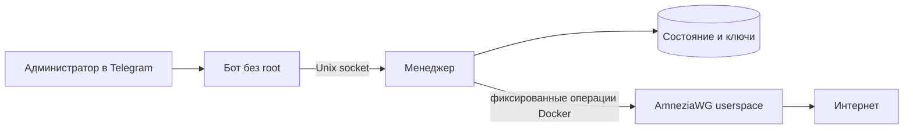

# AmneziaWG Telegram bot

Администраторский бот для одного собственного AmneziaWG 3.1 сервера. За основу взят интерфейс [openvpn_tg_bot](https://github.com/tramboola/openvpn_tg_bot): создание конфигов, повторное скачивание, отзыв доступа, статус и настройки. OpenVPN и сертификаты заменены ключами и устройствами AmneziaWG.

**Статус: образы собраны на Ubuntu VPS, VPN проверен двумя Linux-клиентами. Telegram-бот работает, коллега создаёт конфиги; наблюдался внешний handshake. Коллега пока не подтвердил импорт и интернет на своём устройстве; IPv6 тоже требует проверки.** Результаты и ограничения — в [проверке VPS](.docs/knowledge/vps-verification.md). Перед выдачей коллегам пройдите проверку ниже.

## Что умеет

- Доступ только по разрешённым числовым Telegram ID и только в личном чате.
- Один IPv4/UDP сервер; отдельные ключи, preshared key и адрес для каждого устройства.
- `.conf` для клиентов с поддержкой AmneziaWG 3.1; обычный WireGuard не подходит.
- Повторное создание с тем же именем возвращает действующий конфиг. После отзыва имя можно использовать снова с новыми ключами.
- Отзыв в сохранённых настройках и работающем VPN; при ошибке применения менеджер повторяет его каждые 10 секунд. До успешного применения устройство может оставаться подключённым. Статус показывает неприменённые изменения.
- Остановка сохраняет конфиги. Полное удаление требует подтверждения и сбрасывает все ключи.
- Суффикс имени файла, например `alice-phone_team.conf`, без изменения ключей.

## Схема



Бот не получает Docker socket или серверное хранилище. Менеджер работает с Docker и поэтому имеет права, сопоставимые с root на VPS; его API доступен только через Unix socket с ограниченными правами. Он управляет контейнером `amnezia_tg_awg` с меткой владельца. Контейнер без нужной метки не изменяется.

Состояние хранится в томе `amnezia_tg_data`, настройки имён — в `amnezia_tg_bot_data`. Перезапуск и пересоздание контейнеров сохраняют ключи. Пользовательский модуль ядра AWG не нужен; контейнеру необходимы `/dev/net/tun` и `NET_ADMIN`.

При удалении сначала сохраняется намерение остановить VPN, затем удаляется контейнер и только после этого стираются ключи. Если последний шаг записи не удаётся, сервер останется остановленным, ключи сохранятся и удаление можно повторить. Менеджер не запустит такой сервер автоматически.

## Установка на Ubuntu VPS

Нужны доступ root/sudo, Docker Engine с Compose plugin, публичный IPv4, рабочий TUN и доступ к GitHub, Docker Hub, PyPI и Telegram. Для сборки на небольшом VPS используется Alpine-образ Go, компиляция пакетов по одному и последовательная сборка сервисов Compose. `GOMEMLIMIT=384MiB` — мягкий предел Go, а не гарантия общего расхода памяти. Потребление ресурсов ещё не измерено на VPS; при нехватке памяти потребуется отдельное решение по сборке или ресурсам сервера.

1. Создайте бота через **@BotFather**, получите токен. Определите числовые Telegram ID администраторов; username не используется.
2. Загрузите этот проект на VPS. Из его папки выполните:

   ```bash
   sudo bash install.sh
   ```

3. Установщик проверит TUN, установит Docker при его отсутствии, соберёт образы и запросит токен скрытым вводом и ID администраторов. Повторный запуск не перезаписывает существующие настройки.
4. Откройте бота, отправьте `/start`, укажите **публичный IPv4 именно VPS** и UDP-порт, например `1.2.3.4:51820`. Определённый автоматически адрес проверьте, особенно за NAT.
5. Откройте этот UDP-порт в firewall VPS и панели провайдера. Docker публикует порт сам и может обходить правила UFW; ограничивайте входящий доступ также средствами провайдера. Не меняйте правила SSH вслепую.
6. Подтвердите запуск, нажмите «Создать конфиг», введите `alice-phone`. Скачайте `.conf` и импортируйте его в подходящий клиент.

Установщик не создаёт VPS и не меняет внешний firewall. Занятый UDP-порт выявляется при публикации контейнера Docker; при ошибке запуск останется в ожидаемом состоянии, его можно остановить через `/stop`. Для смены endpoint нужно удалить сервер и выдать новые конфиги.

Если бот ещё не создан, подготовьте Docker и образы отдельно:

```bash
sudo bash install.sh --prepare-only
```

Этот режим не запрашивает токен и не запускает сервисы проекта. После создания бота выполните `sudo bash install.sh`: сборка использует уже подготовленный кеш, затем появятся запросы токена и ID администраторов.

Файлы передаются через Telegram и содержат приватные ключи. Используйте отдельный конфиг для каждого устройства. Доступ SSH, токен и серверные резервные копии не передавайте коллегам. Меню публичной самостоятельной выдачи здесь нет.

## Ручной запуск с установленным Docker

Создайте локальные настройки на VPS:

```bash
cp .env.example .env
# Укажите разрешённые ID в .env.
sudo install -d -m 0700 secrets
# Сохраните токен скрытым вводом, без аргументов команд и истории оболочки:
read -r -s -p 'Bot token: ' task_bot_token; printf '\n'
printf '%s\n' "$task_bot_token" | sudo tee secrets/bot_token >/dev/null
unset task_bot_token
sudo chown 10001:10001 secrets/bot_token
sudo chmod 0600 secrets/bot_token
chmod 0600 .env
sudo docker build -t amnezia-tg-awg:3.1 vpn
sudo docker compose up -d --build
```

Том и имена контейнера фиксированы: один экземпляр проекта на Docker host. Параллельно устанавливать второй экземпляр с другими ключами нельзя. Протокол менеджера не принимает пути, shell-команды, имена контейнеров или Docker-образов из Telegram.

## Проверка на VPS перед выдачей коллегам

1. Проверьте `sudo docker compose ps`: менеджер healthy, бот running. `/status` должен показать работающий VPN без неприменённых изменений.
2. Создайте два устройства. Импортируйте первое в актуальный клиент AmneziaWG 3.1. Проверьте handshake и открытие сайтов; внешний IPv4 должен стать адресом VPS. DNS должен работать через туннель.
3. Проверьте второе устройство одновременно: подключение не должно вытеснять первое. Повторно скачанный первый конфиг должен сохранять ключи и адрес.
4. Проверьте IPv6 на клиенте с работающим IPv6 вне VPN: при включённом VPN прямого выхода через провайдера быть не должно. Эта версия даёт интернет по IPv4; IPv6 направляется в туннель и блокируется сервером. Поддержка маршрутов зависит от клиента — это обязательная проверка.
5. Отзовите первое устройство во время подключения. Его трафик должен прекратиться, второе продолжает работать. Затем отзовите последнее устройство и убедитесь, что доступ прекратился.
6. Создайте новое устройство и проверьте его после `sudo docker compose restart`, затем после `sudo docker restart amnezia_tg_awg`, затем после перезагрузки VPS. Конфиг и серверные ключи должны сохраняться; отозванные конфиги не работают.
7. Проверьте `/stop` и `/init`: действующие конфиги снова работают. Чужой Telegram ID и групповой чат не получают меню или конфиги.
8. На тестовом сервере проверьте отказ Docker во время отзыва и последующее восстановление: до применения бот сообщает ошибку, после восстановления доступ прекращается. Полное удаление проверяйте только после проверки резервной копии.

Тесты Python используют замену внешнего Docker и не доказывают работу TUN, AWG parser, NAT, маршрутизации и импорта на телефонах. Сборка и этот сценарий — отдельный этап при доступном VPS.

## Обновление и обслуживание

Перед обновлением сделайте защищённую резервную копию серверного тома. Остановите менеджер через `sudo docker compose stop manager`, чтобы получить согласованный снимок. Пример копирования тома без вывода ключей в терминал:

```bash
sudo install -d -m 0700 /root/amnezia-backup
sudo docker run --rm --network none \
  -v amnezia_tg_data:/data:ro -v /root/amnezia-backup:/backup \
  alpine:3.24.2 sh -c 'umask 077; tar -czf /backup/vpn-state.tar.gz -C /data .'
sudo docker compose start manager
```

Архив содержит ключи всех устройств; храните его зашифрованным вне VPS. Старый снимок может вернуть ранее отозванные устройства — после восстановления примените актуальный список отзывов. Восстановление тома выполняйте при остановленных менеджере и VPN.

Обновите исходники, пересоберите образы и пересоздайте сервисы:

```bash
sudo docker build -t amnezia-tg-awg:3.1 vpn
sudo docker compose up -d --build
# В боте /stop, затем /init — пересоздать VPN из нового образа с теми же ключами.
```

`docker compose down` останавливает бота/менеджер, но отдельно запущенный VPN остаётся работать. Для полной остановки сначала `/stop`. **Не используйте `docker compose down -v`**: удаление томов уничтожает ключи и состояние. Команды `awg showconf` и `awg show ... dump` выводят секреты; для диагностики используйте `/status` или `awg show awg0 latest-handshakes`.

Изменения устройств применяются через `awg syncconf`: оставшиеся устройства сохраняют текущие сессии, отсутствующие peers удаляются, включая отзыв последнего устройства. При полном перезапуске VPN клиенту потребуется новый handshake; восстановление может занять время до его автоматической попытки переподключения. Healthcheck не переустанавливает неизменённый конфиг.

MTU 1280 оставляет место для транспортных заголовков, S4 и дополнительного padding на обычном пути с MTU 1500. Если сеть VPS использует меньший MTU, параметры потребуется отдельно проверить и согласованно изменить на сервере и клиентах.

## Разработка

```bash
python -m venv .venv
# Linux: source .venv/bin/activate; Windows: .venv\Scripts\Activate.ps1
python -m pip install -e '.[dev]'
python -m pytest -q
ruff check .
```

Код — `src/amnezia_bot`, тесты — `tests`, образ VPN — `vpn`, решения и план — `.docs`. На Windows при недоступном системном temp укажите `--basetemp=work/pytest-local`.

## Источники и лицензии

Интерфейс и сценарии адаптированы из [tramboola/openvpn_tg_bot](https://github.com/tramboola/openvpn_tg_bot/tree/a0b5a5cec629e9a7509f5f3fa468d10ffc91efce), Unlicense. Этот бот также выпущен под Unlicense; сторонние компоненты сохраняют свои лицензии.

Образ собирает официальные [amneziawg-go](https://github.com/amnezia-vpn/amneziawg-go/tree/b5928efb6ca19f0153958460c3d141f04abc5c2e) и [amneziawg-tools](https://github.com/amnezia-vpn/amneziawg-tools/tree/ee0f0a9aa34ff0a0da4b3433b9512781cfe02843) по закреплённым commit SHA. Базовые образы закреплены по digest. Python-зависимости пока заданы диапазонами и разрешаются при сборке; полной воспроизводимости сборки это не обеспечивает.

Параметры AWG 3.1 сверены с [официальным README](https://github.com/amnezia-vpn/amneziawg-go/blob/b5928efb6ca19f0153958460c3d141f04abc5c2e/README.md). Выбранные параметры — начальные настройки, успех обхода блокировок зависит от сети. Документация клиентов: [AmneziaWG](https://docs.amnezia.org/ru/documentation/instructions/use-amneziawg-app/), [переход на новый self-hosted AWG](https://docs.amnezia.org/ru/documentation/instructions/new-amneziawg-selfhosted/). Alpine 3.24 выбрана из [поддерживаемых веток](https://alpinelinux.org/releases/).
